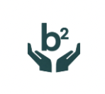

```{=html}
<header class="lh-hero">
  <canvas id="contours" aria-hidden="true"></canvas>
  <div class="lh-wrap">
    <div>
      <div class="lh-eyebrow">Data science · Economics · Applied math</div>
      <h1>Lizzie Healy</h1>
      <p class="lh-role">Data scientist and analyst</p>
      <p class="lh-avail"><span class="dot" aria-hidden="true"></span>Open to data scientist and analyst roles · Philadelphia area</p>
      <p class="lh-lede">I'm passionate about data accuracy and pre-processing, and I enjoy making data accessible through clear presentation and communication of results.</p>
      <div class="lh-cta">
        <a class="lh-btn primary" href="projects.html">View projects
          <svg viewBox="0 0 16 16" fill="none" stroke="currentColor" stroke-width="2" aria-hidden="true"><path d="M3 8h10M9 4l4 4-4 4"/></svg></a>
        <a class="lh-btn" href="resume.html">Resume</a>
        <a class="lh-btn" href="https://www.linkedin.com/in/lizzie-healy-4465a8240">LinkedIn</a>
        <a class="lh-btn" href="https://github.com/ehealy19">GitHub</a>
      </div>
    </div>
    <div class="lh-portrait"><span class="lh-initials">LH</span></div>
  </div>
</header>
```

::: {.lh-block #about}
::: {.lh-wrap}
## About

::: {.lh-about}
::: {.lh-about-text}
I earned a Master of Science in Data Science and Analytics from Georgetown University, after a B.A. in Quantitative Economics with a minor in Applied Mathematics from Haverford College.

My work sits where economics meets machine learning: causal questions about film and labor markets, route optimization to cut delivery emissions, and large-scale text analysis of how cities talk online.

Browse my projects below, and feel free to reach out.

```{=html}
<!-- EDIT: email button. Click copies the address; if copying isn't possible it opens an email instead. -->
<button type="button" class="lh-btn lh-email" data-copy-email="emh201@georgetown.edu" aria-label="Copy email address emh201@georgetown.edu">
  <svg viewBox="0 0 24 24" fill="none" stroke="currentColor" stroke-width="2" stroke-linecap="round" stroke-linejoin="round" aria-hidden="true"><rect x="8" y="8" width="12" height="12" rx="2"/><path d="M16 8V6a2 2 0 0 0-2-2H6a2 2 0 0 0-2 2v8a2 2 0 0 0 2 2h2"/></svg>
  <span class="lh-email-text">emh201@georgetown.edu</span>
</button>
<span class="lh-sr" aria-live="polite" data-copy-status></span>
```
:::

```{=html}
<!-- EDIT: each card is a link to the school's site. To move a photo's focus, change object-position (e.g. "center 60%"). -->
<div class="lh-edu">
  <a class="lh-edu-photo" href="https://analytics.georgetown.edu/" target="_blank" rel="noopener" aria-label="Georgetown Data Science and Analytics program (opens in a new tab)">
    
    <span class="lh-visit">Visit program ↗</span>
    <span class="lh-award-badge"><svg viewBox="0 0 24 24" fill="none" stroke="currentColor" stroke-width="2" stroke-linecap="round" stroke-linejoin="round" aria-hidden="true"><circle cx="12" cy="9" r="6"/><path d="M9 14.5 7.5 22l4.5-2.5 4.5 2.5L15 14.5"/></svg>Returning Student Scholar</span>
    <div class="txt">
      <span class="lh-edu-mark"></span>
      <div><div class="lh-mono">M.S.</div><h3>Georgetown University</h3><p>Data Science and Analytics</p></div>
    </div>
  </a>
  <a class="lh-edu-photo" href="https://www.haverford.edu/economics" target="_blank" rel="noopener" aria-label="Haverford Economics department (opens in a new tab)">
    
    <span class="lh-visit">Visit department ↗</span>
    <span class="lh-award-badge"><svg viewBox="0 0 24 24" fill="none" stroke="currentColor" stroke-width="2" stroke-linecap="round" stroke-linejoin="round" aria-hidden="true"><circle cx="12" cy="9" r="6"/><path d="M9 14.5 7.5 22l4.5-2.5 4.5 2.5L15 14.5"/></svg>John B. Hurford Scholar</span>
    <div class="txt">
      <span class="lh-edu-mark"></span>
      <div><div class="lh-mono">B.A.</div><h3>Haverford College</h3><p>Quantitative Economics · Minor in Applied Mathematics</p></div>
    </div>
  </a>
</div>
```
:::
:::
:::

::: {.lh-block #spotlight}
::: {.lh-wrap}
```{=html}
<!-- EDIT: the Greener Pastures spotlight. Links and numbers live here; styling is .lh-spot in styles.css. -->
<section class="lh-spot" aria-labelledby="spot-title">
  <a class="lh-bb" href="https://benevolentbandwidth.org/" target="_blank" rel="noopener" title="The Benevolent Bandwidth Foundation"></a>
  <div class="lh-spot-text">
    <span class="lh-spot-tag">From research to real tool</span>
    <h2 id="spot-title">Greener Pastures, now an open-source delivery tool</h2>
    <p>My Georgetown capstone asked whether smarter routing could make a small business greener. Using real Mother's Day 2025 delivery data from a Pennsylvania florist, I compared the shop's manual routes with routes optimized by VROOM and OSRM.</p>
    <p><a href="https://benevolentbandwidth.org/" target="_blank" rel="noopener">The Benevolent Bandwidth Foundation</a>, which builds AI tools for nonprofits and NGOs, selected the project to be fully prototyped and open-sourced. The resulting Delivery Optimizer lets small businesses like florists and dry cleaners upload their delivery addresses and get back an efficient route, saving time, fuel and emissions.</p>
    <div class="lh-cta">
      <a class="lh-btn primary" href="https://delivery-optimizer--b2-delivery-optimizer.us-east4.hosted.app/" target="_blank" rel="noopener">Try the live tool ↗</a>
      <a class="lh-btn" href="https://github.com/benevolentbandwidth/delivery-optimizer" target="_blank" rel="noopener">Code on GitHub ↗</a>
      <a class="lh-btn" href="https://medium.com/@kkovalenko_86987/b0af9a0133ef" target="_blank" rel="noopener">Medium article ↗</a>
      <a class="lh-btn" href="projects/greener-pastures/index.html">Read my paper →</a>
    </div>
  </div>
  <div class="lh-spot-stats">
    <div class="lh-mono lh-spot-cap">Optimized vs. manual routes · Mother's Day 2025</div>
    <dl>
      <div><dt>Time saved</dt><dd>89<span> min</span></dd></div>
      <div><dt>Distance saved</dt><dd>66.8<span> mi</span></dd></div>
      <div><dt>Fewer trips</dt><dd>4</dd></div>
      <div><dt>Cost saved</dt><dd><span>$</span>512.36</dd></div>
    </dl>
  </div>
</section>
```
:::
:::

::: {.lh-block #experience}
::: {.lh-wrap}
## Experience

<!-- EDIT: the timeline. Copy a whole ::: {.lh-job tabindex="0"} block (including its .lh-tl-node logo) to add a role, newest first. Bullets show on hover. -->
::: {.lh-tl}
::: {.lh-job tabindex="0"}
::: {.lh-tl-node}

:::

::: {.lh-when}
Jan 2026 – Present
:::

### Data Visualization Specialist I

::: {.lh-org}
Cencora · Conshohocken, PA
:::

- Work directly with Power BI (Desktop and Service), Claude, VSCode, MCP servers, Confluence
- Develop user assistance resources and learning materials to support enterprise-wide adoption of Copilot across M365 products
- Support migration from Power BI Premium to Microsoft Fabric capacities SKUs and from SAP BOBJs to Power BI
:::

::: {.lh-job tabindex="0"}
::: {.lh-tl-node}

:::

::: {.lh-when}
August 2025 – December 2025
:::

### Teaching Assistant

::: {.lh-org}
Georgetown University · Washington, DC
:::

- TA for DSAN 5100: Probabilistic Modeling and Statistical Computing
- Graded assignments and held office hours
:::

::: {.lh-job tabindex="0"}
::: {.lh-tl-node}

:::

::: {.lh-when}
June 2025 – August 2025
:::

### Data and Analytics Intern

::: {.lh-org}
Cencora · Conshohocken, PA
:::

- Worked with the IT team responsible for ensuring seamless access, usability, and integrity of enterprise data for customers
- Led an initiative to evaluate the effectiveness of Copilot integration within Power BI to enhance end-user productivity
:::

::: {.lh-job tabindex="0"}
::: {.lh-tl-node}

:::

::: {.lh-when}
December 2024 – December 2025
:::

### Leadership Committee, Founding Member

::: {.lh-org}
Georgetown Women in Data · Washington, DC
:::

- Helped lead an organization empowering women in data at Georgetown through career-focused events and women-centered gatherings
- Led all communication and member engagement, using Mailchimp and Canva
:::

::: {.lh-job tabindex="0"}
::: {.lh-tl-node}

:::

::: {.lh-when}
August 2024 – May 2025
:::

### Athletics Event Assistant

::: {.lh-org}
Georgetown University · Washington, DC
:::

- Supported operations for five collegiate athletic teams, including event setup, scorekeeping, and statistics
:::
:::
:::
:::


::: {.lh-block #featured-work}
::: {.lh-wrap}
::: {.lh-sec-head}
## Recent work

[All projects →](projects.qmd){.lh-mono}
:::

::: {#featured}
:::
:::
:::
